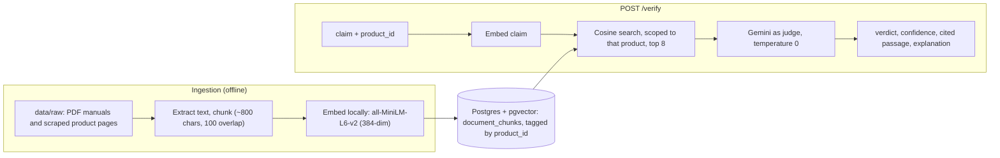
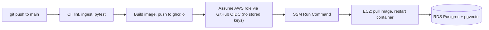

# RAG Claim Verifier

[](https://github.com/haritaparikh05/rag-claim-verifier/actions/workflows/ci.yml)

Given a product claim (for example "waterproof to 30 meters", "BPA-free", "12-hour battery life") and a product's official documentation, this system returns a verdict - **supported**, **contradicted**, or **unverifiable** - backed by the exact passage it is grounding the answer in.

It is deliberately a **verification task, not a chatbot**: the model is given a claim plus retrieved evidence and must classify whether the evidence supports it, instead of writing a free-form answer that might hallucinate. That makes the output checkable (every verdict points at a quoted passage) and measurable (it is a classification problem with ground truth).

## Quick demo

You need Docker Desktop and a free Gemini API key from Google AI Studio (aistudio.google.com).

```bash
git clone https://github.com/haritaparikh05/rag-claim-verifier.git
cd rag-claim-verifier
cp .env.example .env        # open .env and set GEMINI_API_KEY=your-key
docker compose up
```

Then open **http://localhost:8000**.

On the first run, the app image is built (PyTorch and the embedding model are downloaded once and baked in), the nine products' documents are loaded into Postgres (373 chunks), and the app starts only after loading has finished. In testing, a clean start took about a minute and a half on a fast connection, and a restart with the data kept took under 10 seconds.

What to try:
- **Single claim:** pick a product and click an example or a demo claim. You get a verdict badge, the quoted passage, the confidence and the response time. The AI service on the free tier is not fast or steady (we measured anywhere from 1 to 25 seconds per answer).
- **Batch:** paste up to 25 claims for one product, or upload a CSV with the claims in the first column. They are checked three at a time, the table fills in live, and the results download as CSV.
- **Results:** http://localhost:8000/results shows the evaluation scores (development set, held-out set and the FEVER benchmark), computed from the committed result files, with the caveats.
- **API:** interactive documentation is at http://localhost:8000/docs, and the endpoints are described below.

Stop it with `Ctrl+C` or `docker compose down` (add `-v` to also delete the loaded data). If the page says no documents are loaded, run `docker compose run --rm ingest`. If it reports that the AI service's limit was reached, wait a minute and try again. To run it from Python without building the app image, see "Run it from Python" below.

## What a verdict looks like

```
POST /verify
{"product_id": "jbl_flip_6", "claim": "IP67 waterproof and dustproof"}

{
  "verdict": "supported",
  "confidence": 1.0,
  "cited_passage": "IP67 waterproof and dustproof",
  "explanation": "The official documentation explicitly states that the JBL Flip 6 is 'IP67 waterproof and dustproof'."
}
```

The other two verdicts, for the same product. A claim the documentation contradicts:

```
{"product_id": "jbl_flip_6", "claim": "24 hours of battery life"}

{
  "verdict": "contradicted",
  "confidence": 1.0,
  "cited_passage": "Music play time: up to 12 hours (dependent on volume level and audio content)",
  "explanation": "The documentation states that the battery life is up to 12 hours, which directly contradicts the claim of 24 hours."
}
```

And a claim the documentation never addresses, which is reported as unverifiable instead of guessed at:

```
{"product_id": "jbl_flip_6", "claim": "has a built-in flashlight"}

{
  "verdict": "unverifiable",
  "confidence": 1.0,
  "cited_passage": "",
  "explanation": "The provided documentation makes no mention of whether the product has a built-in flashlight."
}
```

## How it works



1. **Ingestion** (`ingestion/ingest.py`) extracts text from PDFs (`pypdf`) and saved web pages, chunks it with custom logic, embeds each chunk locally, and stores it in Postgres with pgvector, tagged by `product_id`.
2. **Retrieval** (`app/retrieval.py`) embeds the claim and runs a cosine-similarity search restricted to **one product's chunks** (`WHERE product_id = ...`), returning the top 8.
3. **Verdict** (`app/verdict.py`) is an LLM-as-judge step: claim plus retrieved passages in, structured JSON out (`verdict`, `confidence`, `cited_passage`, `explanation`).
4. **API** (`app/main.py`) is a FastAPI service exposing `POST /verify` and `GET /health`.

## Results

Three evaluations, deliberately kept separate because they test different things. All numbers below are for the Gemini judge that the app uses.

| Evaluation | What it tests | Result |
|---|---|---|
| Dev set (`eval/run_eval.py`, 27 cases) | The full pipeline (retrieval + verdict) against this project's real documents: one true, one false and one unverifiable claim per product. The prompt rules were developed against these cases. | **27 / 27 (100%)** |
| Held-out set (`eval/run_eval.py --set holdout`, 27 fresh cases) | The same pipeline on claims written after the prompt was fixed. Never used to change any prompt or rule. | **25 / 27 (92.6%)** |
| FEVER benchmark sample (`eval/run_fever_eval.py`, 300 examples per run) | Whether the judge logic generalizes to independently labeled data (retrieval is bypassed, since FEVER claims are not about these products) | **75.67%, 75.33%, 74.33%** on three random samples (seeds 42, 777, 2024) |

How to read these honestly:
- The 100% on the dev set is a development result: the prompt rules were written from its failures. **The held-out 92.6% is the number to quote for unseen claims.**
- Both product sets are small and written by the project author, so one case is worth 3.7 points. They are regression checks for the pipeline, not general accuracy claims.
- The two held-out misses: for "is made in the USA" (the product page says "Country of Origin: China") the judge answered unverifiable, and for "has a built-in heating element for making soup" it cited "not intended for hot blending" as a contradiction, a stretch from a passage that does not address a heating element.
- FEVER measures generic Wikipedia claims, so it is a transfer check of the judging logic, not product accuracy. Tuning stopped once changes were indistinguishable from run-to-run noise (about 1 point); a further change was only accepted if it held on a fresh, unseen seed.

## LLM judge vs a dedicated NLI model

As a side experiment, I compared the Gemini judge with two small NLI models (purpose-built entailment classifiers that run locally, with no API) on the same retrieved chunks. This is offline only; the deployed app does not use them.

| Judge | Held-out product claims (27) | FEVER (3 samples of 300) | Time per example |
|---|---|---|---|
| Gemini (the app's judge) | **92.6%** | 74.3 to 75.7% | about 1 to 25 s |
| NLI large | 81.5% | not evaluated (trained on FEVER) | 9.7 s on a laptop CPU |
| NLI base | 55.6% | 64.7 to 65.7% | 0.45 s |

- The LLM judge is more accurate, mostly because it is better at recognizing that a claim is simply not mentioned. NLI models tend to call an unrelated statement a contradiction.
- The gap to the large NLI model is not statistically significant on 27 claims; the base model is clearly worse.
- One improvement I decided on in advance (scoring only the top 3 chunks) did not help, and I report it as a negative result instead of tuning further.
- The experiment also showed that the 100% on the original dev set was optimistic, which is why the fresh held-out set exists.

Full method, tables, caveats and reproduce commands: [docs/judge_comparison.md](docs/judge_comparison.md).

## Design decisions

- **Local embeddings.** `sentence-transformers` (`all-MiniLM-L6-v2`) runs on the machine for both ingestion and query time: free, no rate limits, no API key for that half of the pipeline.
- **Pinned Gemini model, temperature 0.** The verdict model is `gemini-3.5-flash-lite`, pinned rather than a `-latest` alias (the alias pointed at a model with a 20-requests-per-day free quota). It is a fast classification task with one right answer, so temperature 0 and a light model fit.
- **Custom chunking.** Written from scratch (not a library splitter) so the behavior is explainable: about 800 characters with 100 of overlap, and a new chunk starts at every all-caps section header so a spec table is not diluted by unrelated text.
- **Multi-language manuals.** Some PDFs repeat instructions in about 24 languages. The English section is kept whole, and in other languages only non-prose lines (icon legends, numeric spec tables) survive, using a line-level filter. A whole-segment "drop by language" rule wrongly deleted spec data that sits under a foreign-language marker purely because of page layout.
- **Prompt rules found by failing.** The judge prompt contains explicit rules added after real misclassifications: threshold reasoning ("at least 1.1 m" supports a claim of 1 m), "a passage must address the same attribute, not just share a keyword", and "do not use outside world knowledge". Each came from a concrete failing case.
- **Retrieval depth of 8, not 5.** Raised after a regression where the correct chunk ranked sixth.
- **Verified, not trusted.** The HuggingFace dataset card for the FEVER data had its field mapping backwards; the mapping used here was checked against the actual rows.

## Run it from Python

For development: Postgres runs in Docker, and the app and scripts run from a Python environment. Prerequisites: Python 3.11+, Docker, and a free Gemini API key from Google AI Studio.

```bash
git clone https://github.com/haritaparikh05/rag-claim-verifier.git
cd rag-claim-verifier
python3 -m venv venv
./venv/bin/pip install -r requirements.txt

cp .env.example .env          # then put your Gemini key in GEMINI_API_KEY

docker compose up -d db       # Postgres with pgvector
./venv/bin/python -m ingestion.ingest   # chunk, embed and load data/raw (about a minute)
./venv/bin/uvicorn app.main:app --port 8000
```

Try it:

```bash
curl -s -X POST localhost:8000/verify \
  -H "Content-Type: application/json" \
  -d '{"product_id": "jbl_flip_6", "claim": "IP67 waterproof and dustproof"}'
```

Available `product_id` values:

| Category | `product_id` | Source |
|---|---|---|
| Outdoor gear | `alps_helix_2` (ALPS Helix 2-person tent) | scraped product page |
| Outdoor gear | `black_diamond_spot_400` (Spot 400 headlamp) | official PDF manual and product page |
| Outdoor gear | `nalgene_32oz_wide_mouth` (32 oz bottle) | scraped product page |
| Electronics | `jbl_flip_6` (Flip 6 speaker) | official spec sheet PDF |
| Electronics | `anker_313_powercore_10k` (313 power bank) | scraped product page |
| Electronics | `soundcore_life_q20` (Life Q20 headphones) | scraped product page |
| Kitchen | `instant_pot_duo` (Duo 7-in-1) | official PDF manual |
| Kitchen | `philips_airfryer_hd9252` (Airfryer L) | official PDF manual |
| Kitchen | `ninja_blender_bl621` (Professional blender BL621) | official PDF manual |

All sources are publicly available manufacturer documentation, used for a personal, non-commercial project.

## API

**`POST /verify`** - body: `product_id` and `claim` (1 to 500 characters). Returns `verdict` (`supported`, `contradicted` or `unverifiable`), `confidence` (0 to 1), `cited_passage` (exact quoted text, empty when unverifiable), `explanation` (one sentence) and `latency_ms` (server time spent on the claim). Errors carry a plain-language `detail`: `422` for an empty, missing or over-long claim or a missing product, `404` for an unknown product, `429` when the AI service's limit is reached, `503` when it is busy, the database is unreachable or no documents are loaded, and `502` when the AI service rejects the request (for example, a bad API key).

**`POST /verify/batch`** - body: `product_id` and `claims` (a list of 1 to 25 claims). The response streams newline-delimited JSON: a `start` line, one `result` line per claim as it finishes (each with its input `index`; a failed claim carries `error` and `status`), and a `done` line with totals. At most three claims run at a time and call starts are spaced at least 4 seconds apart, to stay inside the free tier. If the AI service's limit is reached, the remaining claims are skipped and the finished results are still returned.

**`GET /products`** - the nine products with friendly names, categories, example claims and how many chunks are loaded (0 means ingestion has not run).

**`GET /results`** and **`GET /api/results`** - the evaluation page and its data, computed from the committed result files.

**`GET /health`** - checks that the service can actually reach and query the database. Returns `200 {"status": "ok", "database": "ok"}`, or `503 {"status": "degraded", "database": "unreachable"}`.

Every response carries an `x-request-id` header (an incoming one is honored), and the same ID appears in the logs.

## Tests and evaluation

```bash
./venv/bin/python -m pytest                 # 96 tests
./venv/bin/python -m eval.run_eval                   # the 27-case dev set (uses the Gemini API)
./venv/bin/python -m eval.run_eval --set holdout     # the 27 fresh held-out cases
./venv/bin/python -m eval.run_fever_eval --seed 42   # FEVER sample (hundreds of Gemini calls)
```

The NLI comparison commands are in [docs/judge_comparison.md](docs/judge_comparison.md).

The test suite covers the ingestion logic (including regression tests for the multi-language and chunking bugs), retrieval against a real Postgres, the verdict step with Gemini mocked, and the API. The model is mocked in tests, so the suite never spends API quota; model quality is measured separately by the evals above.

## CI/CD and deployment

On every push and pull request, GitHub Actions lints with `ruff`, starts a real `pgvector` Postgres service, loads the schema, ingests the product documents, and runs the full test suite. On a push to `main` that passes, a second job builds the Docker image, pushes it to GitHub's container registry, and deploys it.



- **No long-lived secrets in CI.** The deploy job authenticates to AWS with short-lived GitHub OIDC tokens, and the role it assumes can only run commands on one instance and only from this repository's `main` branch.
- **No open SSH port.** The deploy goes through AWS Systems Manager, so the server has no inbound SSH exposure for automation.
- **Where things run.** The app runs in a Docker container on an EC2 instance, backed by RDS Postgres with pgvector, with raw source documents kept in a private S3 bucket. The project is sized to stay within AWS free-tier credits.
- **Observability.** The API writes one JSON log line per event (including a `verify` record with product, verdict, confidence, chunks retrieved and latency), which made it easy to see that the Gemini call, not retrieval, dominates latency.

## Known limitations

- **Small corpus and small evals.** Nine products and 373 chunks. Both 27-case product sets are hand-written by the author, so one case is worth 3.7 points: they are regression checks, not benchmarks. The NLI comparison is offline only and rests on the same small sets.
- **The judge is an LLM.** Quality depends on a hosted model. During development, an unchanged prompt and unchanged data started misclassifying one case after an upstream model update (the pipeline dropped from 100% to 96.3% until the prompt was tightened). Pinning a model name does not freeze its behavior.
- **Latency and quotas.** On the free tier, the time for one `/verify` call varies widely (from about 1 second to over 20 seconds in testing), and almost all of it is the Gemini call, not retrieval. The daily quota is also limited.
- **Retail-page noise.** Four products come from scraped web pages that include navigation, pricing and reviews; retrieval usually still surfaces the right passage, but the chunks are noisier than the PDF manuals.
- **No authentication on the API or the web page.** They are meant to be run locally with your own key. The deployed instance is restricted by a firewall to the author's IP address and is not a public service. Adding an API key and per-user rate limits is the next hardening step before any public demo.
- **Batch mode is deliberately slow.** One product per run, at most 25 claims, three at a time with call starts at least 4 seconds apart, so a full batch of 25 takes at least about a minute and a half. That pacing keeps it inside the free tier of the AI service.
- **Single instance, no load balancer or HTTPS.** The instance is stopped when idle to conserve credits, so there is no always-on public demo.
- **Simple retrieval.** Fixed top-k with no reranking or hybrid search, and one product per request. Claims that depend on combining facts across products are out of scope.
- **Manual ingestion.** Ingestion is a command run by hand against local files; the S3 bucket holds a copy but is not wired into the pipeline.

## Repository layout

```
app/          FastAPI app: main.py (API and pages), retrieval.py, verdict.py, batch.py, products.py,
              errors.py, results.py, logging_config.py; static/ holds the web pages
demo/         claims.json (six demo claims with their expected and observed results)
ingestion/    ingest.py (extract, chunk, embed, store) and inspect_db.py (checks the database)
eval/         run_eval.py (product sets), run_fever_eval.py (FEVER sample), metrics.py,
              nli_judge.py, run_nli_eval.py, compare_judges.py (offline NLI comparison)
tests/        pytest suite
docs/         judge_comparison.md (LLM vs NLI write-up)
data/raw/     source documents, one folder per product
data/eval/    dev and held-out eval sets and committed result files
docker/       init.sql (pgvector extension and table schema)
.github/      CI/CD workflow
```
